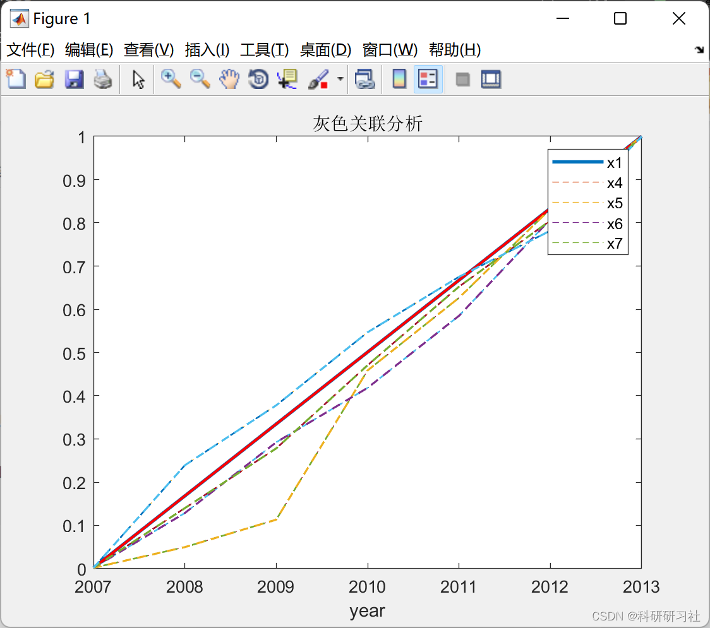
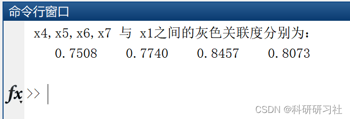
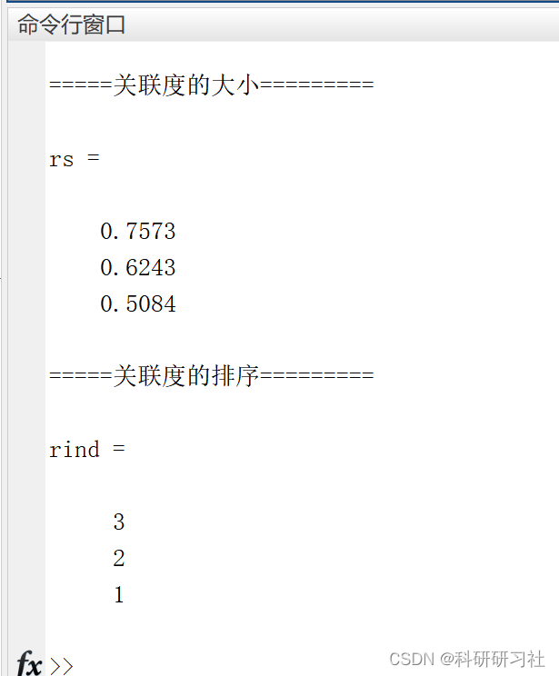
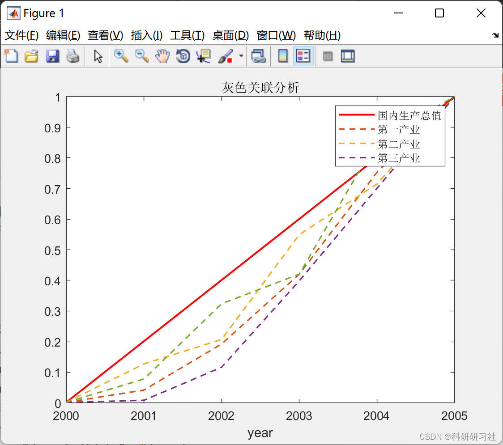
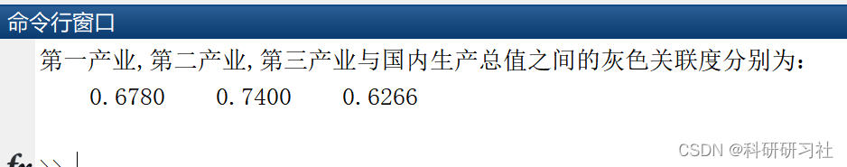
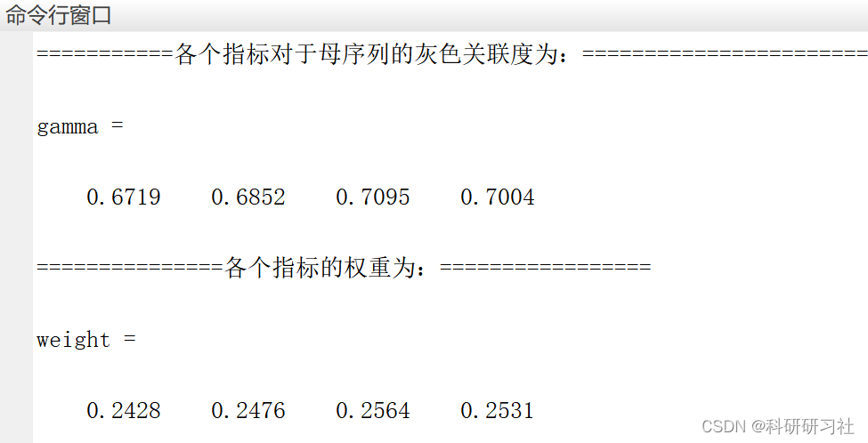
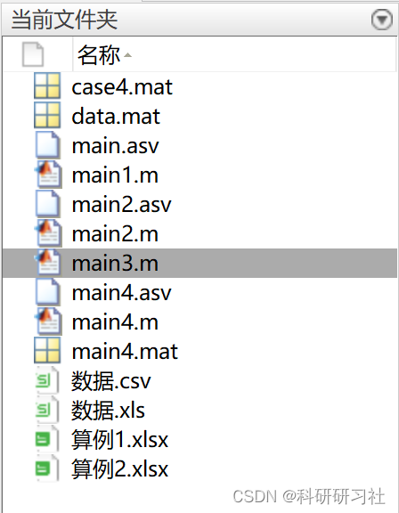

# [Mathematical Modeling]Grey Relational Analysis (Matlab Code Implementation)

1. Grey Relational Analysis
Grey Relational Analysis (GRA) is advantageous because it addresses the limitations of systematic analysis using mathematical statistics, being applicable to both small and large sample sizes and whether the samples follow a pattern. It also has low computational requirements, making it very convenient and unlikely to yield results that contradict qualitative findings. However, GRA is only used by some scholars in China and not widely recognized internationally. Moreover, when data volumes are large, standardized regression methods are preferable. Only when data is scarce and unavoidable should GRA be considered. Of course, one could consider both approaches.
2. Example and MATLAB Code Implementation
2.1 Example:
The example involves six indicators: x1: freight transportation volume; x2: port cargo throughput; x3: goods turnover volume; x4: GDP; x5: fiscal revenue; x6: per capita disposable income of urban residents; x7: net per capita disposable income of rural residents. The study aims to calculate the grey relational degree between the x4-x7 indicators and the x1 indicator. The data table is as follows:
Year x1 x2 x3 x4 x5 x6 x7   2007 22578 27569 4987 2567.7 267.98 1.5429 1.172   2008 25698 29484 5048 3131 348.51 1.8546 1.2514   2009 27896 31589 5129 3858.2 429.1 2.0369 1.0254   2010 29540 34894 5569 4417.7 541.29 2.2589 1.189   2011 31058 36478 5783 5158.1 647.25 2.4276 1.4213   2012 35980 38695 6045 6150.1 736.45 2.5678 1.5304   2013 39483 40746 6259 7002.8 850 2.8546 1.7421   2)MatlabCode implementation  
clc;\nclear;\n% Reading data\ndata=xlsread('Example1.xlsx');\n% Data standardization\ndata1=mapminmax(data',0.002,1); % Standardized to a range of 0.002-1\ndata1=data1';\n%% Draw the line chart for x1,x4,x5,x6,x7. Here, replace the data with your own.\nfigure(1)\nt=[2007:2013];\nplot(t,data1(:,1),'Color','r','LineWidth',1.5)\nhold on \nfor i=1:4\n    plot(t,data1(:,3+i),'--','LineWidth',1.2)\n    hold on\nend\nxlabel('year')\nlegend('x1','x4','x5','x6','x7')\ntitle('Gray Relational Analysis')\n \n%% Calculate the Grey Relational Coefficient\n% Obtain the absolute values that are equal to other columns and reference columns\nfor i=4:7\n    data1(:,i)=abs(data1(:,i)-data1(:,1));\nend\n \n% Obtain the global maximum and minimum values of the absolute value matrix\ndata2=data1(:,4:7);\nd_max=max(max(data2));\nd_min=min(min(data2));\n% Grey Relational Matrix\na=0.5;   % Recognition coefficient\ndata3=(d_min+a*d_max)./(data2+a*d_max);\nxishu=mean(data3);\ndisp(' x4,x5,x6,x7 Withx1The grey relational degree between them is respectively: ')\ndisp(xishu)\n  
2.2 Example 2: 1) Analysis of the impact of the industry on GDP:
Data:
Years: 2000, 2001, 2002, 2003, 2004, 2005
GDP: 1988, 2061, 2335, 2750, 3356, 3806
Primary Industry: 839, 408, 422, 482, 511, 561
Secondary Industry: 763, 846, 960, 1258, 1577, 1893
Tertiary Industry: 633, 808, 953, 1010, 1268, 1352
2) Matlab code implementation
clc;\nclose;\nclear all;\nx=xlsread('Example2.xlsx');\n%load data.mat;\nx=x(:,2:end)';% All columns, from 2 to the last column\n%===Get the number of rows and columns=====\ncolumn_num=size(x,2);\nindex_num=size(x,1);\n\n%% 1. Data mean normalization processing\nx_mean=mean(x,2);\nfor i = 1:index_num\n    x(i,:) = x(i,:)/x_mean(i,1);\nend\n%% 2. Extract reference queue and comparison queue\nck=x(1,:)\ncp=x(2:end,:)\ncp_index_num=size(cp,1);\n\n%==2.1 Compare the difference between queue and reference queue===\nfor j = 1:cp_index_num\n    t(j,:)=cp(j,:)-ck;\nend\n%===2.2 Finding the maximum and minimum difference ========\nmmax=max(max(abs(t)))\nmmin=min(min(abs(t)))\nrho=0.5;\n%% 3. Calculate the correlation coefficient\nksi=((mmin+rho*mmax)./(abs(t)+rho*mmax))\n\n%% 4. Calculate the correlation\nksi_column_num=size(ksi,2);\nr=sum(ksi,2)/ksi_column_num;\n\n%% 5. Correlation ranking, resulting in r3 > r2 > r1\n[rs,rind]=sort(r,'descend')\n\ndisp('=====The degree of association=========')\nrs\ndisp('=====Ranking of relevance=========')\nrind\n\n  
Editor
2.3 Example 3: Applying the method of example 1 to example 2, for simple teaching purposes.
clc;\nclear;\n% Reading data\ndata=xlsread('Example2.xlsx');\n% Data standardization\ndata1=mapminmax(data',0.002,1); % Standardized to a range of 0.002-1\ndata1=data1';\n%% Draw the line graph of x1,x4,x5,x6,x7, replace the data with your own.\nfigure(1)\nt=[2000:2005];\nplot(t,data1(:,1),'Color','r','LineWidth',1.5)\nhold on \nfor i=1:4\n    plot(t,data1(:,1+i),'--','LineWidth',1.2)\n    hold on\nend\nxlabel('year')\nlegend('Gross domestic product','Primary industry',\t'Second Industry',\t'Thirteenth industry')\ntitle('Gray Relational Analysis')\n \n%% Calculate the Grey Relational Coefficient\n% Obtain the absolute values that are equal to other columns and reference columns\nfor i=2:4\n    data1(:,i)=abs(data1(:,i)-data1(:,1));\nend\n \n% Obtain the global maximum and minimum values of the absolute value matrix\ndata2=data1(:,2:4);\nd_max=max(max(data2));\nd_min=min(min(data2));\n% Grey Relational Matrix\na=0.5;   % Recognition coefficient\ndata3=(d_min+a*d_max)./(data2+a*d_max);\nxishu=mean(data3);\ndisp('Primary industry,Second Industry,The grey correlation degree between tertiary industry and GDP is respectively: ')\ndisp(xishu)\n  
Editor
2.4 Example 4: 1) Example
Grey Relational Analysis for River Conditions
Data:
River oxygen content PHValue of total bacteria(One/ml) Plant-based nutritional substances(ppm)   A 4.69 6.59 51 11.94   B 2.03 7.86 19 6.46   c 9.11 6.31 46 8.91   D 8.61 7.05 46 26.43   E 7.13 6.5 50 23.57   F 2.39 6.77 38 24.62   G 7.69 6.79 38 6.01   H 9.3 6.81 27 31.57   I 5.45 7.62 5 18.46   J 6.19 7.27 17 7.51   K 7.93 7.53 9 6.52   L 4.4 7.28 17 25.3   M 7.46 8.24 23 14.42   N 2.01 5.55 47 26.31   o 2.04 6.4 23 17.91   p 7.73 6.14 52 15.72   Q 6.35 7.58 25 29.46   R 8.29 8.41 39 12.02   s 3.54 7.27 54 3.16   T 7.44 6.26 8 28.41   2)MatlabCode  
% Grey Relational Analysis to Evaluate River Conditions\nclear;clc;\nload case4.mat;\n% Get the number of rows and columns\nr = size(case4,1);\nc = size(case4,2);\n% First, we normalize our original indicator matrix\n%Middle column intermediate--->Extreme large\nmiddle = input('Please enter the best intermediate value.: ');\nM = max(abs(case4(:,2)-middle));\nfor i=1:r\n      case4(i,2) = 1-abs(case4(i,2)-middle)/M;\nend\n% Third column ---> Extremely Small to Extremely Large\nmax_value = max(case4(:,3)); \ncase4(:,3) = abs(case4(:,3)-max_value);\n% Fourth column interval type --> Largest\na = input('Please enter the lower bound of the interval: ');\nb = input('Please enter the lower bound of the interval: ');\nM = max(a-min(case4(:,4)),max(case4(:,4))-b);\nfor i=1:r\n       if (case4(i,4)<a)\n            case4(i,4) = 1-(a-case4(i,4))/M;\n       elseif (case4(i,4)<=b&&case4(i,4)>=a)\n           case4(i,4) = 1;\n       else\n           case4(i,4) = 1-(case4(i,4)-b)/M;\n       end\nend\ndisp('The matrix after normalization is: ');\ndisp(case4);\n% Preprocess the normalized matrix to eliminate the effects of scale\navg = repmat(mean(case4),r,1);\nnew_X = case4./avg;\n% Take the maximum value of each row in the preprocessed matrix and use it as the mother sequence (hypothetical)\nY = max(new_X,[],2);\n% Calculate the gray relational degree of various indicators and their corresponding sequences.\n% First, subtract all elements in the new_X matrix from the corresponding elements in the mother sequence and take the absolute value.\nY2 = repmat(Y,1,c);\nnew_X = abs(new_X-Y2);\na = min(min(new_X)); % Minimum value of the entire matrix\nb = max(max(new_X)); % Maximum value of the entire matrix\nro = 0.5;\nnew_X = (a+ro*b)./(new_X+ro*b);\ndisp('===========The grey relational degree of each index to the mother sequence: ========================');\ngamma = mean(new_X)\n% Calculate the weights of various indicators\ndisp('===============The weights of various indicators are as follows:: =================');\nweight = gamma./(sum(gamma,2))\n%-------------------------------------------------------------------------------------------------------\n% Continue with the steps of TOPSIS: Standardize the normalized matrix X (dividing the original matrix by the square root of the sum of elements in each column)\ntemp1 = case4.*case4;               % Let each element square first.\ntemp2 = sum(temp1);         % Sum each column again\ntemp3 = temp2.^0.5;         % square the result again\ntemp4 = repmat(temp3,r,1);  % Copy the square root results row by row\ndisp('******The standardized matrix is: ');\nZ = case4./temp4               % Divide the original matrix by the square root of the sum of each column element\nZ_max = max(Z)           % Get the largest element in each column of Z\nZ_min = min(Z)           % Obtain the smallest element in each column of Z\nD_max = sum(weight.*(Z-repmat(Z_max,r,1)).^2,2).^0.5\nD_min = sum(weight.*(Z-repmat(Z_min,r,1)).^2,2).^0.5\ndisp('The matrix score is...: ')\nS = D_min./(D_max+D_min)\ndisp('After normalization, the score is: ');\nS = S./(repmat(sum(S),r,1))\n  
Editor
3. Conclusion
If the code adjustments are incorrect, I have packaged it and you can directly download and learn:
[Mathematical Modeling] Grey Relation (Matlab Code Realization)

## Images

<!-- PAYMENT_BLOCK -->

## Get this dataset

- Payment link (Stripe): [Buy now](https://buy.stripe.com/3cs8yP7sY87d0vu9AB)
- Payment QR code: 

<!-- /PAYMENT_BLOCK -->
